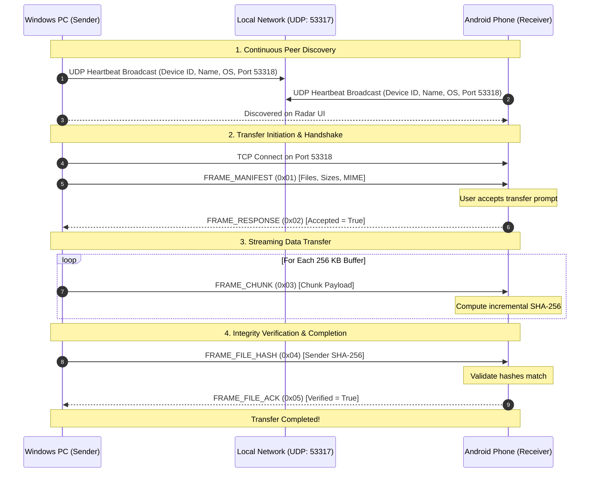

<div align="center">

# ⚡ BeamDrop

**Ultra-Fast, Private Local P2P File Transfer Between Windows & Android**  
*The open-source, zero-cloud AirDrop alternative for Windows and Android.*

[](https://tauri.app)
[](https://www.rust-lang.org)
[](https://react.dev)
[](https://www.typescriptlang.org)
[](https://tailwindcss.com)
[](https://github.com/pritamjoardar/AirDrop-Production)
[](LICENSE)

<br />

<p align="center">
  <a href="#-downloads">📥 <strong>Download Apps</strong></a> •
  <a href="#-features">✨ <strong>Key Features</strong></a> •
  <a href="#-how-it-works">🧠 <strong>Architecture</strong></a> •
  <a href="#-building-from-source">🛠️ <strong>Build from Source</strong></a> •
  <a href="#-protocol-specification">📡 <strong>Protocol Spec</strong></a>
</p>

</div>

---

## 🌟 Overview

**BeamDrop** solves the fragmented ecosystem between Windows PCs and Android devices. It provides an Apple AirDrop-like zero-configuration experience that discovers nearby devices over your local Wi-Fi, Ethernet, or mobile hotspot, transferring raw photos, 4K videos, directories, and documents at maximum physical link speed.

- **No Cloud Required:** 100% offline peer-to-peer transmission. Zero third-party servers, zero data caps, zero tracking.
- **Blazing Speeds:** Saturates local Wi-Fi 6 / 5GHz links at **80–120+ MB/s** (10x faster than Bluetooth or cloud syncing).
- **End-to-End Integrity:** Incremental chunked SHA-256 verification guarantees bit-perfect file arrival without corruption.
- **Beautiful Radar UI:** Interactive, animated radar showing discovered devices with real-time speedometers, progress bars, and ETA indicators.

---

## 📥 Downloads

Grab the official binaries directly from the repository:

| Platform | Download Link | Type | Size | Min Requirements |
| :--- | :--- | :--- | :--- | :--- |
| **Windows (Standalone)** | [**BeamDrop-Windows.exe**](public/downloads/BeamDrop-Windows.exe) | Portable Executable | ~6.9 MB | Windows 10 / 11 (64-bit) |
| **Windows (Installer)** | [**BeamDrop-Setup.exe**](public/downloads/BeamDrop-Setup.exe) | NSIS Setup Wizard | ~3.5 MB | Windows 10 / 11 (64-bit) |
| **Android (APK)** | [**BeamDrop-Android.apk**](public/downloads/BeamDrop-Android.apk) | Native APK (arm64-v8a) | ~146.9 MB | Android 8.0 Oreo+ |

> [!TIP]
> **Android Installation Note:** When downloading the `.apk` on your Android device, tap **Open** and allow installation from unknown sources in Chrome / your file manager if prompted.

### Checksums (SHA-256)
- **Windows Executable:** `14DABBB2EA9422A712D74B87DCDC90D9DB2504E1641765AA8EF8BAB058874F4D`
- **Android APK:** `09CAA5D3DD0BA089B81CB0166342D927419E1AC7BCF07BA45937AFF6037E9C92`

---

## ✨ Features

- **Automatic Device Discovery (Zero Configuration)**  
  Uses local UDP multicast and broadcast heartbeats on port `53317`. Discovers nearby Windows, Android, and macOS/Linux peers instantly without pairing or PIN codes.
- **High-Throughput Streaming Engine**  
  Tokio asynchronous TCP streaming pipeline running on Rust with optimized 256 KB memory chunk buffers and up to 4 parallel concurrent streams.
- **Folder & Batch Transfers**  
  Select individual files or full directory trees. BeamDrop packages and streams hierarchy trees seamlessly.
- **Visual Radar View**  
  Interactive scanning radar with platform-specific badges (Desktop, Smartphone, Laptop), signal indicators, and drag-and-drop target nodes.
- **Drop Zone Anywhere**  
  Drag files directly over the radar or specific peer avatars to start transfers with a single gesture.
- **Interactive Transfer Modal & History**  
  Real-time transfer metrics including current transfer speed (MB/s), bytes transferred, elapsed time, ETA countdown, and file-by-file status.
- **Transfer Consent & Security**  
  Receiving peers receive an explicit transfer prompt showing the sender name, device type, file manifest, and total size before any bytes are written to disk.
- **Customizable Storage Path**  
  Easily select or change default download directories directly inside the application settings.

---

## 🧠 Architecture & How It Works



---

## 📡 Protocol Specification

BeamDrop operates on a low-latency binary framing protocol:

| Frame Byte | Name | Payload Description |
| :---: | :--- | :--- |
| `0x01` | `FRAME_MANIFEST` | JSON manifest detailing transfer ID, sender info, item count, and file entries (name, size, MIME type). |
| `0x02` | `FRAME_RESPONSE` | Peer decision flag (`accepted: bool`) and optional custom destination metadata. |
| `0x03` | `FRAME_CHUNK` | Binary file chunk with 256 KB buffer payload. |
| `0x04` | `FRAME_FILE_HASH` | 32-byte SHA-256 digest calculated by sender for the completed file stream. |
| `0x05` | `FRAME_FILE_ACK` | Verification acknowledgement from receiver confirming disk write and hash match. |
| `0x06` | `FRAME_CANCEL` | Instant cancellation signal terminating the stream and cleaning incomplete partial files. |

- **Default Discovery Port:** `53317 (UDP)`
- **Default Transfer Port:** `53318 (TCP)`
- **Heartbeat Interval:** `2 seconds`
- **Peer Stale Timeout:** `5 seconds`

---

## 🛠️ Building from Source

### Prerequisites

1. **Node.js** (v18.0.0 or later) & **npm**
2. **Rust** toolchain: `rustup default stable`
3. **C++ Build Tools:**
   - **Windows:** Visual Studio C++ Build Tools with Windows 10/11 SDK.
   - **Android:** Android SDK, NDK (`27.1.12297006`), and Java JDK 17 / 21.

### 1. Clone the Repository
```bash
git clone https://github.com/pritamjoardar/AirDrop-Production.git
cd AirDrop-Production
```

### 2. Install Frontend Dependencies
```bash
npm install
```

### 3. Run in Development Mode (Hot-Reloading)
```bash
npm run tauri dev
```

### 4. Build Windows Desktop Release
```bash
npm run tauri build
```
The compiled output will be generated in `src-tauri/target/release/`.

### 5. Build Android APK
Ensure `$env:ANDROID_HOME` and `$env:NDK_HOME` are configured, then execute:
```powershell
powershell -ExecutionPolicy Bypass -File ./build_apk.ps1
```
The output will be placed in `BeamDrop-Android.apk` and copied to `public/downloads/`.

---

## 📂 Project Structure

```text
AirDrop/
├── public/                       # Static web & release assets
│   ├── downloads/                # Publicly downloadable binaries for website
│   │   ├── BeamDrop-Android.apk  # Android APK distribution (tracked via Git LFS)
│   │   ├── BeamDrop-Setup.exe    # Windows NSIS installer
│   │   └── BeamDrop-Windows.exe  # Standalone Windows executable
│   ├── hero-banner.jpg           # Presentation assets
│   └── og-preview.png            # Open Graph social banner
├── src/                          # React + TypeScript frontend
│   ├── components/               # Modular UI components
│   │   ├── DropZoneOverlay.tsx   # Drag-and-drop drop zone overlay
│   │   ├── FolderPickerModal.tsx # Directory selection dialog
│   │   ├── Header.tsx            # Navigation header & device status
│   │   ├── IncomingTransferModal.tsx # Approval modal for incoming transfers
│   │   ├── PeerAvatar.tsx        # Dynamic peer avatar & OS badges
│   │   ├── RadarView.tsx         # Circular scanning radar visualization
│   │   ├── SettingsModal.tsx     # Device name & port settings
│   │   ├── TransferHistory.tsx   # Transfer history logs
│   │   ├── TransferModal.tsx     # Live transfer progress modal
│   │   └── WebsiteView.tsx       # Embedded download showcase website
│   ├── services/
│   │   └── tauriBridge.ts        # IPC bridge between React & Rust backend
│   ├── types.ts                  # Shared TypeScript interfaces
│   ├── App.tsx                   # Main application router & state controller
│   └── index.css                 # Tailwind CSS v4 styling & animations
├── src-tauri/                    # Tauri v2 Rust native core
│   ├── src/
│   │   ├── discovery.rs          # UDP peer discovery engine
│   │   ├── transfer.rs           # TCP high-speed streaming & framing protocol
│   │   ├── lib.rs                # Tauri command bindings & IPC handlers
│   │   └── main.rs               # Application entrypoint
│   ├── capabilities/             # Tauri v2 permission capabilities
│   ├── gen/android/              # Native Android gradle & Kotlin wrapper
│   ├── Cargo.toml                # Rust dependencies
│   └── tauri.conf.json           # Tauri v2 configuration
├── .gitattributes                # Git LFS tracking configuration
├── .gitignore                    # Production unified ignore rules
├── build_apk.ps1                 # Automated Android build script
└── package.json                  # Node.js dependencies & scripts
```

---

## 🔒 Privacy & Security

- **Strictly Local Network:** No data, metadata, or telemetry is ever sent over the public internet.
- **Zero Cloud Accounts:** No sign-in, email, phone number, or credentials required.
- **Consent-Driven Transfers:** Files cannot be silently received without explicit user approval on the receiving device.
- **Firewall Friendly:** Uses standard user-level sockets without requiring administrative escalation beyond local port allowance.

---

## 📄 License

This project is licensed under the [MIT License](LICENSE) - see the LICENSE file for details.

---

<div align="center">
  <sub>Built with ❤️ using Tauri v2, Rust, and React.</sub>
</div>
